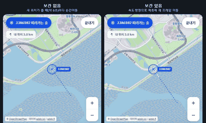

# 내 머리 위 비행기 (flight-overhead)

내 위치 상공(반경 20km)을 지나는 비행기를 지도 위에 실시간으로 보여주는 웹 서비스입니다. 기획 의도와 범위는 [`docs/PLAN.md`](docs/PLAN.md)에 있습니다.

- 서비스: https://flight-overhead.vercel.app
- 서버: https://flight-overhead.onrender.com/health (Render 무료 플랜이라 15분 동안 접속이 없으면 잠들어, 첫 접속은 1분 가까이 걸릴 수 있습니다. 낮 시간에는 cron-job.org가 10분마다 `/health`를 불러 깨워 두고, 새벽에는 무료 사용 시간을 아끼려고 멈춥니다. 서버 상태는 GitHub Actions의 "서버 상태 확인"으로 직접 확인할 수 있습니다)

## 보간 전후 비교



같은 비행기를 동시에 따라가며 녹화했습니다. 왼쪽은 새 위치를 받을 때(약 5초)마다 그 자리로 옮기기만 하고, 오른쪽은 마지막 위치에서 속도와 방향(선회율)으로 매 프레임 예측해 움직입니다. 오른쪽의 흰 점선은 아직 서버에서 확인되지 않은 예측 구간입니다.

녹화 방법: 개발 서버에서 `?nointerp`를 붙이면 보간을 끈 화면을 볼 수 있습니다(배포 빌드에는 없음).

## 기능

- 반경 20km 안 비행기를 진행 방향으로 회전한 아이콘과 편명으로 표시하고, 약 6초마다 실시간 갱신
- 갱신 사이에도 속도와 방향으로 위치를 예측해 매 프레임 부드럽게 이동 (새 데이터가 오면 1초 동안 새 경로로 합류)
- 하단 카드: 선택한 비행기(선택 전에는 가장 가까운 비행기)의 편명, 고도, 속도, 방향, 나와의 거리
- 처음 들어오면 내 위치를 요청하고, 권한이 없으면 인천공항 기준으로 보여 줌
- 상태 표시: 실시간 / 연결 중 / 재연결 중(마지막 위치를 흐리게) / 데이터 지연("N초 전 기준")
- 반경 안에 비행기가 없으면 가장 가까운 비행기까지의 거리와 "반경 30km까지 넓히기"
- 데이터 소스 두 곳(adsb.lol, adsb.fi)을 번갈아 부르고, 한쪽이 실패하면 다른 쪽으로 자동 전환
- 따라가기: 비행기 하나를 지도 가운데에 고정하고 착륙하거나 신호가 끊길 때까지 같이 이동, 지나온 경로를 점선으로 표시
- 고도별 아이콘 색: 이착륙 주황, 저고도 황토, 중고도 초록, 순항 보라. 오른쪽 아래 "고도" 버튼으로 범례를 펼치고, 카드의 고도 칸에도 색 점과 구간 이름 표시
- 하늘 모드: 폰을 하늘로 들면 그 방향의 비행기를 보여 줌. 센서가 없거나 권한을 거부하면 끌어서 둘러보기

## 현재 상태 (2026-11-14)

- 기획서의 MVP, 따라가기, 하늘 모드까지 완료하고 배포했습니다. 추가 기능 중 고도별 색상까지 했고, 지도 모드의 경로 꼬리(모든 비행기)는 하지 않기로 했습니다.
- 테스트: shared 21, server 75, web 113개 (`pnpm test`)
- 남은 질문과 결정 기록은 [`docs/PLAN.md`](docs/PLAN.md)의 "열린 질문", "결정 기록"에 있습니다.
- 작업마다 남긴 보고서는 `docs/HANDOFF-{월일}-{주제}.md`입니다. 그때의 기록이라 지금과 다른 부분이 있을 수 있습니다.

## 핵심 구현

| 주제 | 어디 | 한 줄 설명 |
| --- | --- | --- |
| 지역 통째 조회 | `apps/server/src/sources/regional.ts` | 한반도를 한 번 조회해 0.1도 격자 토픽마다 나눠 발행. 외부 요청 수가 사용자 수와 상관없음 |
| 소스 번갈아 부르기와 백오프 | `apps/server/src/sources`, `backoff.ts` | 두 소스를 번갈아 부르고 실패하면 다른 소스로 재시도, 둘 다 실패하면 5→10→20→40→60초 |
| 보간 애니메이션 | `apps/web/src/lib/geo/interpolate.ts`, `components/map/AircraftLayer.tsx` | React state를 거치지 않고 `requestAnimationFrame`에서 Leaflet 마커를 직접 이동 |
| 시계 보정 | `apps/web/src/lib/mqtt.ts` | 스냅샷을 받을 때 "내 시계 - 서버 시계"를 기억해, 기기 시계가 틀려도 예측 위치가 어긋나지 않음 |
| 개인정보 | `apps/web/src/hooks/useGridSubscription.ts` | 정확한 위치는 브라우저 안에서만 쓰고, 서버에는 격자 토픽만 보냄 |

## 구조

```
apps/server     Express + Aedes 1.2.0(내장 MQTT 브로커) + ws
apps/web        Vite + React + TypeScript (지도는 react-leaflet, 상태는 zustand)
packages/shared 공통 타입(Aircraft, Snapshot), 토픽 이름, 격자 함수
```

서버가 공개 ADS-B API(adsb.lol, adsb.fi를 번갈아)로 한반도 전체를 5초마다 한 번 조회하고, 격자별로 나눠 그 격자를 구독한 브라우저들에게 MQTT over WebSocket으로 발행합니다. 따라가기 기체는 5초마다 기체 ID로 조회합니다. 브라우저는 위치를 0.1도 격자로 반올림한 토픽만 구독하므로 정확한 위치는 서버에도 외부 API에도 전달되지 않습니다.

| 토픽 | 내용 |
| --- | --- |
| `flights/{lat}/{lon}` (예: `flights/37.5/127.1`) | 격자의 `Snapshot` JSON, retained |
| `status/source` | `ok` / `fallback` / `degraded`, retained |
| `aircraft/{hex}` | 따라가는 기체의 `FollowSnapshot` JSON, retained. 연결 하나당 1개 |

- 구독자가 있는 격자만 폴링하고, 마지막 구독자가 떠나면 멈추고 그 격자의 retained 스냅샷을 지웁니다.
- 서버는 격자 중심에서 반경 21해리(약 39km)를 보내고, 20km 필터와 가장 가까운 비행기 계산은 브라우저가 합니다. 지상 기체는 격자 토픽에서 빠집니다.
- 토픽 이름은 `@flight/shared`의 `snapshotTopic`, `STATUS_TOPIC`으로 만듭니다. 직접 문자열을 만들면 `37.50`처럼 형식이 달라져 구독이 거절될 수 있습니다.
- 외부 요청마다 adsb.lol과 adsb.fi를 번갈아 먼저 부릅니다. 먼저 부른 쪽이 실패하면 같은 요청을 다른 쪽으로 재시도하고(`status/source`가 `fallback`), 둘 다 실패하면 간격을 10초, 20초, 40초, 60초로 늘립니다.
- `ADSB_LOL_API_KEY`가 있으면 adsb.lol 요청에만 `x-api-key`로 붙여, IP가 아니라 키 기준으로 호출 제한을 셉니다.
- 브라우저 연결은 구독만 할 수 있고, 발행하면 연결이 끊깁니다.

## 실행

Node 20.12 이상, pnpm 10이 필요합니다.

```bash
pnpm install
pnpm test          # 전체 단위 테스트 (외부 API는 모두 모킹)
pnpm type-check    # 전체 타입 체크
```

서버 (`http://localhost:4000/health`, MQTT는 `ws://localhost:4000/mqtt`):

```bash
pnpm --filter @flight/server dev
```

동작 확인용 구독 스크립트 (서버를 띄운 상태에서, 60초 뒤 종료. 실제 API를 호출하므로 반복 실행하지 마세요):

```bash
pnpm --filter @flight/server sub
```

프론트엔드 (`http://localhost:5173`):

```bash
pnpm --filter @flight/web dev
```

환경 변수는 [`apps/server/.env.example`](apps/server/.env.example)을 참고하세요. `apps/server/.env`를 만들면 서버 시작 시 읽습니다.

## 데이터 출처

- 지도: © OpenStreetMap contributors
- 비행기 위치: [adsb.lol](https://adsb.lol), [adsb.fi](https://adsb.fi) (비상업 용도)
